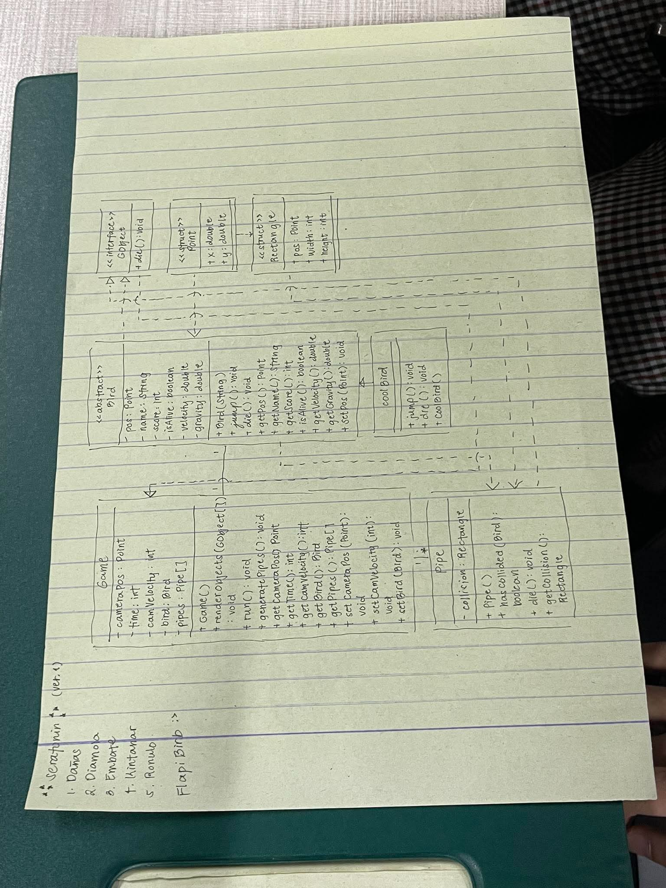

# FlappyBird-CSIT227-Capstone-Seratonin

A cell-based Flappy Bird game built with **Java Swing** and `JTable` for the CSIT227 Object-Oriented Programming capstone. The project explores object-oriented design through game state, rendering, input handling, collision behavior, and leaderboard persistence.

## Team Members

- Alliyah Faith Ronulo
- Dominic Rhowel Embate
- Josh Damien Diamola
- Thomas Jacob Dañas
- Zhian Trinity Kintanar

## Capstone Project

The team is developing a desktop Flappy Bird game in Java. The playfield is represented as a cell-based grid, with a bird controlled by keyboard input and pipes that form moving obstacles. The planned game flow includes a start dialog for player name and bird selection, collision-triggered game over, score tracking, and a persistent leaderboard.

The project is organized around a modular object-oriented design, separating game models, presentation, control logic, data persistence, and custom exceptions. The sprint backlog records the implementation scope and acceptance criteria for each feature.

## Class Diagram

## Requirements

- **JDK 21**
- **IntelliJ IDEA** (Community or Ultimate)
- **Git**
- Java Swing and AWT, included with the JDK

In IntelliJ IDEA, set the Project SDK and language level to 21. Enable the bundled UI Designer plugin if working with `.form` files.

## Run the Project

1. Open the project folder in IntelliJ IDEA with JDK 21 configured.
2. Open [`src/TableGameScreen.java`](src/TableGameScreen.java).
3. Run `TableGameScreen.main()`.

## Project Documentation

- [Sprint Tickets](sprintTickets.md) — sprint backlog, ticket board, and acceptance criteria.
- [How to Collaborate](howToCollaborate.md) — branch naming, Git workflow, commits, and pull requests.
