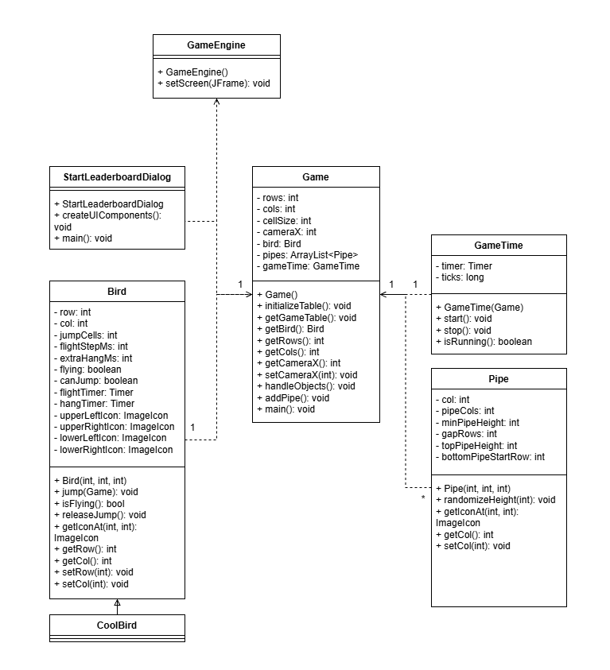

# FlappyBird-CSIT227-Capstone-Seratonin

A cell-based Flappy Bird game built with **Java Swing** and `JTable` for the CSIT227 Object-Oriented Programming capstone. The project explores object-oriented design through game state, rendering, input handling, collision behavior, and leaderboard persistence.

## Team Members

- Alliyah Faith Ronulo
- Dominic Rhowel Embate
- Josh Damien Diamola
- Thomas Jacob Dañas
- Zhian Trinity Kintanar

## Capstone Project

The team is developing a desktop Flappy Bird game in Java. The playfield is represented as a cell-based grid, with a bird controlled by keyboard input and pipes that form moving obstacles. The game flow includes a start dialog for player name and bird selection, collision-triggered game over, score tracking, and a persistent leaderboard.

The project is organized around a modular object-oriented design, separating game models, presentation, control logic, data persistence, and custom exceptions. The sprint backlog records the implementation scope and acceptance criteria for each feature.

## Class Diagram

## Architecture & Design Patterns

The project incorporates creational and structural design patterns to promote code reusability, maintainability, and separation of concerns.

### Creational Design Pattern

- **Singleton (`GameInstance`):** Ensures that only one instance of the `StartLeaderboardDialog` and `Game` windows is created and managed throughout the application. The class uses a private constructor to prevent external instantiation and static methods (`getInstanceOfSLD()` and `getInstanceOfGame()`) to provide controlled access to these instances. This avoids unnecessary window creation and centralizes instance management.

### Structural Design Patterns

- **Facade (`flapibirb.controller.GameFacade`):** Provides a unified entry point through methods such as `startSession()`, `endSession(int score)`, and `preloadSounds()`. It coordinates the `StartLeaderboardDialog`, `Game` window, `SoundManager`, and leaderboard score persistence, allowing the `Main` class to interact with these subsystems without depending on their individual implementations.

- **Decorator (In Development):** Currently being implemented to extend existing game components with additional behavior dynamically without modifying their original classes. This pattern will allow new features or functionalities to be added through decorator classes while preserving the existing component structure.

## Requirements

- **JDK 21**
- **IntelliJ IDEA** (Community or Ultimate)
- **Git**
- Java Swing and AWT, included with the JDK

In IntelliJ IDEA, set the Project SDK and language level to 21. Enable the bundled UI Designer plugin if working with `.form` files.

## Run the Project

1. Open the project folder in IntelliJ IDEA with JDK 21 configured.
2. Open [`src/flapibirb/view/Game.java`](src/flapibirb/view/Game.java).
3. Run `Game.main()`.

## Project Documentation

- [Sprint Tickets](sprintTickets.md) — sprint backlog, ticket board, and acceptance criteria.
- [How to Collaborate](howToCollaborate.md) — branch naming, Git workflow, commits, and pull requests.
